# NeoGeo HackROM Studio — Tutoriales

Lecciones prácticas. Los ejemplos de KOF97 se aplicaron con la app y se comprobaron en FBNeo desde un savestate (Kyo vs Iori).

## 1. Carga un set de ROMs y aprende a moverte

*Empieza aquí · 3 min* — Abre KOF97, lee la página Set de ROMs, entiende deshacer/rehacer y dónde van tus ediciones.

1. Abre **Set de ROMs** y suelta tu `kof97.zip` (de Fightcade: `Fightcade\emulator\fbneo\ROMs\kof97.zip`). No se sube nada y el zip del disco nunca se modifica.
2. Revisa la tarjeta **Juego**: debe decir The King of Fighters '97, NGH `0232`, perfil **documentado** y listar 4 bancos de programa con ids `0000 0001 0002 0003`.
3. Mira los **Puntos de entrada**: `USER $009868`, VBlank `$009EA2`. Ahí es donde la BIOS cede el control al juego.
4. Cada edición que haces aparece en **Generar y exportar → Historial de ediciones** y se puede deshacer con **Ctrl+Z** (rehacer **Ctrl+Y**).
5. ¿Aún no tienes ROM? Pulsa **Probar el set de demostración sintético** en la página Set de ROMs: son datos generados con la estructura de KOF97, puedes romperlos sin problema.

## 2. Cambia los colores de un personaje (paletas)

*Gráficos · 5 min* — Cambia la chaqueta de Kyo de verde a azul editando su paleta en la ROM P2.

1. Abre **Paletas**. En la biblioteca de la izquierda busca **KYO KUSANAGI** y pulsa **A**. El navegador salta a `$2D1FF0` (banco 2) y la convierte en la paleta activa.
2. La fila `$2D1FF0` es la paleta principal de Kyo. Los colores **7 a 12** son la chaqueta y el pantalón (verdes oscuros). Haz clic en el color 7.
3. Sube el control **B** y baja el **G**, o usa el selector de color. Repite con los colores 8-12, cada vez más claros.
4. Abre **Tiles de sprites** o **Personajes y movimientos**: todo lo dibujado con la paleta activa se actualiza al instante.
5. Exporta y ejecuta. En KOF97 la paleta se copia a la RAM de paletas al empezar un round, así que un savestate hecho a mitad de round muestra los colores viejos hasta el siguiente round.

> Atajo: el botón **Aplicar este ejemplo por mí** hace exactamente esta edición.

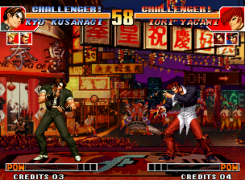
*Original (savestate, round 1)*

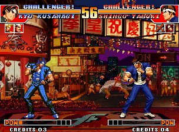
*Tras la edición, round 2 en FBNeo: chaqueta azul*

**Resultado:** Comprobado en FBNeo: tras un KO el siguiente round recarga la paleta $010 desde la ROM y Kyo aparece de azul.

## 3. Edita tiles de sprites

*Gráficos · 5 min* — Encuentra los tiles de los frames de guardia de Kyo y dibuja sobre ellos.

1. Pon primero la paleta de Kyo (tutorial 2, paso 1) para que los tiles muestren los colores reales.
2. Abre **Personajes y movimientos → Animaciones**, elige **Kyo**, ACT **000** (guardia). Despliega **Configuración de la vista previa del sprite**: muestra `frame $0000 → graph … → def $250092 … 5×7 tiles from $10000`.
3. Ve al tile `$10000` en **Tiles de sprites**: es el primer tile del frame de guardia de Kyo. Cada tile muestra sus offsets en los archivos c1/c2.
4. Doble clic en un tile, pinta con el color 1 (blanco), pulsa **Escribir en la ROM**.
5. Mayús+clic para seleccionar un bloque y usa **Exportar PNG** / **Importar PNG** para editar muchos tiles en un editor de imágenes.

> Atajo: el botón **Aplicar este ejemplo por mí** hace exactamente esta edición.

*Original*

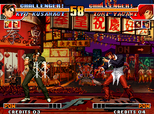
*Marcas blancas dibujadas en los tiles del pecho de Kyo (FBNeo)*

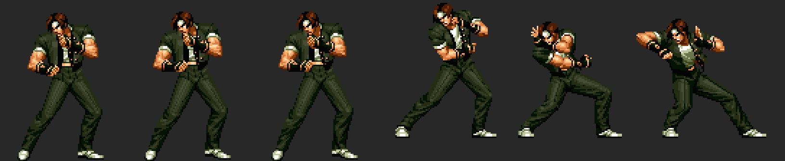
*Frames de Kyo decodificados por la app (guardia 0-2, Oniyaki E1-E3)*

**Resultado:** Comprobado en FBNeo: los gráficos se leen en vivo de la ROM C, así que los cambios en tiles se ven al instante, incluso desde un savestate.

## 4. Construye e importa un frame

*Gráficos · 10 min* — Convierte un PNG en tiles en espacio libre, listos para usarse en una animación nueva.

1. Abre **Constructor de frames**. Ajusta el tile base, las columnas y las filas para ver cualquier bloque de tiles (los sprites de Neo Geo son columnas de 16 px de ancho).
2. Los frames de KOF96-98 guardan una máscara de filas por columna, así que un frame real no siempre es un rectángulo simple; la vista previa de Personajes los decodifica exactamente (tutorial 3, paso 2).
3. Dibuja un frame (máx. 15 colores + transparente, tamaño en múltiplos de 16 px) y pulsa **Importar frame PNG (usar paleta activa)**. La app busca tiles vacíos y escribe ahí el frame.
4. Anota el tile base que aparece en el mensaje: ahí está tu frame. Usa **Importar + crear paleta nueva** para generar también una paleta.

## 22. Reemplaza un frame de sprite de un personaje con tu propio PNG

*Gráficos · 15 min* — Exporta uno de los frames de Kyo tal como lo guarda el juego, redibújalo e impórtalo de vuelta en los mismos tiles.

1. Abre **Personajes y movimientos → Animaciones**, elige **Kyo** y el ACT **051** (A lejano). Haz clic en el frame **#2** de la línea de tiempo: imagen `$3D`, el puñetazo.
2. Despliega **Configuración de la vista previa del sprite**: la disposición de tiles debe ser **máscaras de filas por columna (KOF96-98)**. Muestra `def $25046E … 6×7 tiles`. Pulsa ahí la paleta **A** para que la exportación use los colores de Kyo.
3. Pulsa **Exportar frame PNG** bajo la vista previa. Obtienes un PNG indexado de 96×112 px con los 16 colores de Kyo, mirando a la izquierda como está guardado. Las celdas rosa claro no tienen tile en este frame: solo existen 22 de las 42 celdas.
4. Redibújalo en cualquier editor de píxeles (Aseprite, GIMP, Photoshop en modo indexado…). Mantén el tamaño y la transparencia, usa solo los colores de la paleta (los demás se ajustan al más cercano) y no pintes en las celdas rosas.
5. Pulsa **Importar PNG en este frame** y elige tu archivo. Solo se escriben los píxeles que cambiaron, en los mismos tiles que ya usa el frame. El mensaje indica cuántos tiles cambiaron y cuántos píxeles cayeron en celdas sin tile (esos se ignoran).
6. Si algunos tiles se comparten con otras imágenes (los frames de reposo de Kyo comparten tiles, por ejemplo), la app las lista y pregunta antes, porque esas imágenes también cambian.
7. Importar el PNG exportado sin editarlo no escribe nada: una buena forma de comprobar que tu editor conserva los colores exactos. Después **Generar y exportar** y prueba en FBNeo (tutorial 12).

> Atajo: el botón **Aplicar este ejemplo por mí** hace exactamente esta edición.

**Resultado:** Verificado con el set real de kof97: exportar e importar frames sin cambios da cero bytes de diferencia en las ROMs C, y una edición pintada solo cambia bytes dentro de los tiles del propio frame.

> KOF97 casi no tiene tiles vacíos en sus ROMs C, así que el arte nuevo debe reutilizar los tiles que el frame ya tiene. Para darle más tiles a un frame hace falta una nueva definición de sprite (el tutorial 4 muestra cómo colocar tiles nuevos).

## 5. Edita una animación y sus hitboxes (ACT)

*Personajes y movimientos · 10 min* — Haz que la guardia de Kyo use otra imagen y dale una hurtbox gigante.

1. Abre **Personajes y movimientos → Animaciones**, selecciona **Kyo** y el ACT **000**. Pulsa **Reproducir**: la línea de tiempo muestra 10 frames con sus duraciones; las cajas se dibujan por frame (sólida = activa).
2. Haz clic en cualquier fila de **frame** del script. El campo `img` es el id de imagen. Cambia el img de cada frame a `E3` (una pose del Oniyaki).
3. Busca las filas **FD caja**. Los 2 bits bajos del tipo son el slot; el slot 1 es una hurtbox. Pon su `w` en 40 y su `h` en 50 (medios tamaños).
4. Pulsa **Escribir en la ROM**. Si un script crece se mueve automáticamente a espacio libre.
5. Prueba otros: el ACT `080` es el Oniyaki; su frame 3 tiene la caja de ataque (tipo `A0`, slot 0), efecto `20` (fuego) y cancel `30`.

> Atajo: el botón **Aplicar este ejemplo por mí** hace exactamente esta edición.

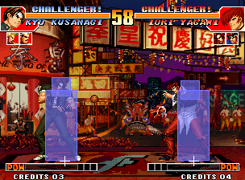
*Guardia original con las cajas superpuestas*

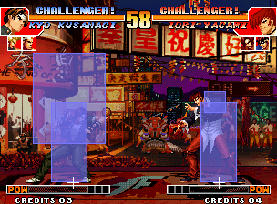
*La guardia muestra la imagen E3 y la hurtbox de 40×50 (FBNeo)*

**Resultado:** Comprobado en FBNeo: los scripts ACT se leen en vivo, la nueva pose y la caja aparecen al instante.

> Las cajas de las capturas las dibuja un script Lua con la misma estructura de RAM que el visor de hitboxes del modo entrenamiento de Fightcade (objeto +$90/$95/$9A/$9F).

## 6. Cambia el comando de un especial

*Personajes y movimientos · 5 min* — Haz que el Oniyaki de Kyo salga con abajo, abajo + cualquier botón.

1. Abre **Personajes y movimientos → Comandos de entrada**, pulsa **Escanear** (55 tablas en KOF97). La tabla `$A6E38` es Kyo mirando a la derecha.
2. El slot **5** apunta a `$A7CD2`: **→ ↓ → cualquiera**, ventana 14: es el Oniyaki (623+P).
3. Cambia las tres primeras direcciones a **↓** y deja el último paso como cualquier botón. Pulsa **Escribir en la ROM**.
4. Los modos de comparación importan: `14` = contiene la dirección (permisivo), `28`/`00` más estrictos, `04` con `F0` = cualquier botón. Ventanas más bajas hacen los comandos más difíciles.

> Atajo: el botón **Aplicar este ejemplo por mí** hace exactamente esta edición.

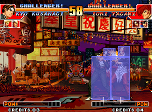
*Original: abajo, abajo+A = normal agachado*

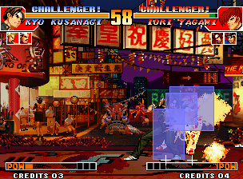
*Editado: abajo, abajo+A = Oniyaki (FBNeo)*

**Resultado:** Comprobado en FBNeo: con la edición, el ACT de P1 pasa a $080 (Oniyaki) e Iori recibe 2 golpes.

## 7. Clona una rutina de movimiento y cambia su daño

*Personajes y movimientos · 10 min* — Copia el código del Oniyaki de Kyo a espacio libre, haz que pegue más fuerte y apunta el movimiento a la copia.

1. Abre **Personajes y movimientos → Rutinas de movimiento**. Filtra `2FCF0`: la fila **set at $019F1A → routine $02FCF0** es el Oniyaki de Kyo. (`$2FEDA` es su Red Kick.)
2. Pulsa **clonar**. La rutina (105 instrucciones) aparece como ensamblador editable; los saltos y punteros al siguiente frame son etiquetas como `L_02FDE4`.
3. Busca las líneas `move.b #$1A,($EF,a4)` / `#$1C` / `#$1B` (daño) y cámbialas a `#$60`.
4. Elige espacio libre (p. ej. `$0F0400`) en **ensamblar en**, pulsa **Ensamblar y escribir** y luego **Redirigir 019F1A a la nueva rutina**.
5. Abre la nueva dirección en **Código 68k** para leer tu rutina.

> Atajo: el botón **Aplicar este ejemplo por mí** hace exactamente esta edición.

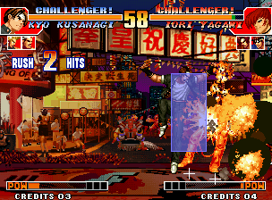
*Daño original del Oniyaki*

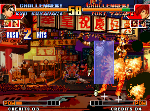
*Rutina clonada en $F0434: mucho más daño (FBNeo)*

**Resultado:** Comprobado en FBNeo: el puntero de rutina de movimiento de P1 ($108298) vale $0F0434 e Iori pierde $19 de vida en vez de $0D.

## 8. Lee y parchea código 68k

*Código · 10 min* — Sigue el bucle principal, etiqueta rutinas y parchea una instrucción.

1. Abre **Código 68k** en `$9C38` (MainLoop_Entry). `$9C50 tst.b ($2785,a5) / beq` espera el VBlank, `$9C5C bsr $9F68` lee las entradas.
2. Doble clic en `bsr.w $9F68` para seguirlo, **←** para volver. Pulsa **Buscar referencias** para ver quién llama a una rutina.
3. Usa **☆ Marcador / etiqueta** para nombrar las rutinas que entiendas; las etiquetas aparecen en todas partes.
4. Parche: selecciona una instrucción, escribe el nuevo ensamblador (p. ej. `nop`) y pulsa **Escribir**. El código más corto se rellena con NOPs; las barras rojas marcan las líneas modificadas.
5. Abre `$101D8`: `movea.l ($198,a4),a0 / jmp (a0)`: aquí es donde un especial reconocido salta a su rutina.

## 9. Ejecuta tu propio código en cada frame (hook del bucle principal)

*Código · 5 min* — Congela el tiempo del round con un hook en el bucle principal.

1. Abre **Bucle principal y hooks**. Se muestra el bucle conocido de KOF97; el punto del hook por defecto es `$9C44` (`move.b #$0,($2785,a5)`, 6 bytes reubicables).
2. Elige espacio libre en P1 (p. ej. `$0F0000`) y la plantilla **Congelar el tiempo del round** (`move.b #$60,$10A83A`).
3. Lee el listado: el punto se convierte en `jmp $0F0000`; el hook guarda los registros, ejecuta tu código, vuelve a ejecutar la instrucción movida y regresa a `$9C4A`.
4. Pulsa **Instalar hook**.
5. Otras plantillas: vida infinita de P1 (`$108239`), poder máximo, o un combo de botones que inicia una rutina de movimiento.

> Atajo: el botón **Aplicar este ejemplo por mí** hace exactamente esta edición.

*Original tras 20 segundos*

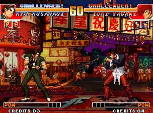
*Con hook: el tiempo se queda en 60 (FBNeo)*

**Resultado:** Comprobado en FBNeo: el tiempo se queda en 60 durante toda la prueba.

## 10. Edita la fuente del HUD (capa fix)

*Gráficos · 5 min* — Cambia los tiles de texto de 8×8 usados en nombres, CREDITS y mensajes.

1. Abre **Capa fix** y ve al tile `$300`: ahí empieza la fuente de KOF97; el texto CREDITS está en `$3E0`.
2. Doble clic en el tile de una letra, edítalo y **Escribir en la ROM**.
3. Usa **Exportar página PNG** para ver una página entera de tiles de fuente de una vez.

> Atajo: el botón **Aplicar este ejemplo por mí** hace exactamente esta edición.

*HUD original*

*Tiles de fuente $300-$3FF reflejados (FBNeo)*

**Resultado:** Comprobado en FBNeo: el texto del HUD se dibuja reflejado al instante.

## 11. Busca y edita bytes en crudo

*Código · 5 min* — Usa patrones para encontrar el código de todos los personajes de una vez.

1. Abre **Editor hex**, archivo `232-p1.p1`. Busca `397C 0080 00D2` (`move.w #$80,($D2,a4)`): 30 resultados, uno por el especial ACT $80 de cada personaje.
2. Ve al offset `$A7CD2` para ver los bytes del comando del Oniyaki `04 0E 00 00 14 08 28 02 04 08 04 F0`.
3. Haz clic en un byte y escribe para sobrescribirlo. Los bytes modificados se ponen en rojo; el panel del cursor muestra la dirección 68k y el valor original.

## 13. Lee una animación frame a frame

*Movimientos en detalle · 10 min* — Entiende la duración, imagen, efecto, cajas y cancel de cada frame del A lejano de Kyo.

1. Lee primero **Guías y documentación → Sistema de animación (KOF)**: muestra cómo encajan entrada → manejador → rutina → ACT → frames → tiles.
2. Abre **Personajes y movimientos → Animaciones**, elige **Kyo** y el ACT **051** (A lejano). En *Configuración de la vista previa del sprite* elige la paleta **A** de Kyo.
3. El script tiene 3 frames de 3 frames cada uno. El frame 2 (imagen `$3D`) selecciona los slots 0+1+2 (`sel 07`); el slot 0 es la caja de ataque roja: tipo `30` (normal débil), x `-36`, y `-84`, medio tamaño `28×8`, así que alcanza 36+28 = 64 px por delante.
4. Su último byte es `cc`: hitstun C, cancel C (cancel total); por eso el A lejano cancela en cualquier cosa. El frame 3 vuelve a tener solo hurtboxes.
5. Pulsa **▶ Reproducir** y mira la línea de tiempo: naranja = duración, GOLPE marca el frame activo. Compara con el ACT `0B5` (88 Shiki): dos frames de ataque, cancel `00`.

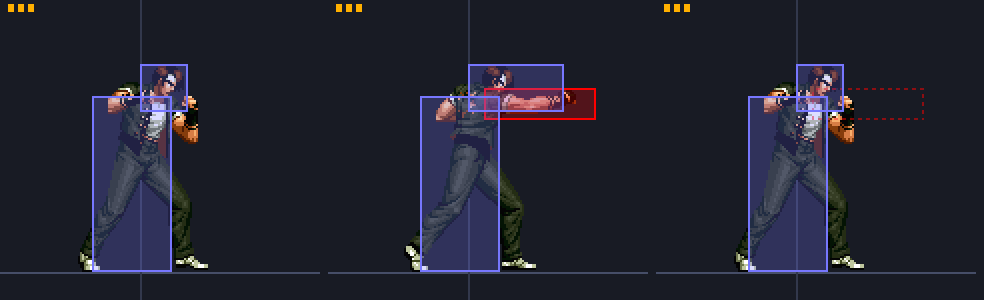
*A lejano de Kyo dibujado por la app: marcas de duración, hurtboxes (azul), caja de ataque (rojo), cajas inactivas discontinuas*

## 14. Agranda una hitbox

*Movimientos en detalle · 5 min* — Dale al A lejano de Kyo un puño que cruce la pantalla.

1. Abre **Animaciones**, Kyo, ACT **051**. Haz clic en la fila **FD caja** con tipo `30` (slot 0, ataque).
2. Alcance = |x| + w = 36 + 28 = 64 px. Al empezar el round los luchadores están a 160 px y la caja del cuerpo de Iori mide 20 px de ancho, así que necesitas |x| + w ≥ 140: pon **w = 120** (alcance 156). La altura es h (media altura).
3. Pulsa **Escribir en la ROM** (o **⚡ Probar en vivo** con el emulador conectado).
4. Las cajas más grandes también necesitan que la hurtbox del oponente se superponga: un ataque alto necesita más h, uno bajo una y más baja.

> Atajo: el botón **Aplicar este ejemplo por mí** hace exactamente esta edición.

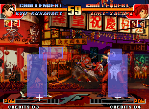
*A lejano original al empezar el round: la caja roja se queda en el aire*

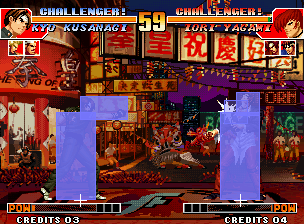
*w = 120: el mismo A lejano golpea a Iori al otro lado de la pantalla (FBNeo)*

**Resultado:** Comprobado en FBNeo: Iori pasa al ACT de golpe $100, vida $67 → $63, desde la posición de inicio del round.

## 15. Haz un movimiento cancelable (88 Shiki de Kyo, ↘+D)

*Movimientos en detalle · 5 min* — El 88 Shiki de Kyo no se puede cancelar. Haz que cancele en especiales y supers.

1. Encuentra el movimiento: **Lista de movimientos → Kyo** muestra el normal de comando comprobado en `$19A90` → rutina `$322D8` → ACT **B5**. Ese es el 88 Shiki (↘ + D).
2. Abre **Animaciones → Kyo → ACT 0B5**. Sus dos frames de ataque son las filas con **eff `04`** (golpe bajo), imágenes `7E` y `82`; ambas tienen **stun/cxl `00`** = no cancelable.
3. Pon esos dos bytes en **`04`** (hitstun 14f, cancel a especiales y supers). Usa `08` para solo especiales o `0C` para cualquier cosa. No toques el nibble alto para conservar el hitstun.
4. Escribir en la ROM / ⚡ Probar en vivo.
5. Cómo cancelar en el juego: la patada debe **tocar** al oponente y el comando del especial debe terminarse **durante la pausa de impacto**; el juego comprueba el byte de cancel en cada frame de la pausa (código en `$163EE` → `$1E5AA`).

> Atajo: el botón **Aplicar este ejemplo por mí** hace exactamente esta edición.

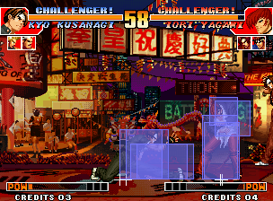
*Original: el 88 Shiki golpea, el comando del Oniyaki se ignora*

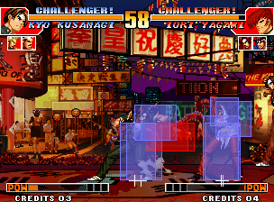
*Cancel 04: el Oniyaki sale del golpe del 88 Shiki (FBNeo)*

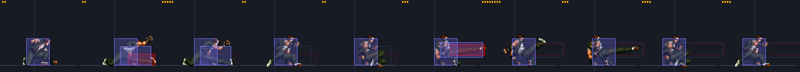
*Frames del ACT B5: frames de ataque 2 y 6 (rojo)*

**Resultado:** Comprobado en FBNeo: con la misma entrada el original sigue reproduciendo el ACT $B5 y el editado cambia al Oniyaki (rutina $2FCF0, ACT $80) en el frame 490.

## 16. Dale armadura a un movimiento

*Movimientos en detalle · 10 min* — Kyo recibe el golpe pero sigue haciendo el 88 Shiki.

1. KOF97 no tiene flag de armadura en la animación. Lo que sí tiene: cuando el byte del objeto atacante **+$E6 bit 0** está activo, sus golpes hacen daño pero **no causan reacción**.
2. Así que armadura para P1 = un hook en el bucle principal que activa el bit 0 de `$1083E6` de **P2** mientras P1 hace el movimiento (código de ACT de P1 en `$108172` = `$B5`) y lo borra en otro caso.
3. Abre **Bucle principal y hooks**, deja el punto `$9C44`, elige espacio libre (p. ej. `$0F0000`) y la plantilla **Armadura mientras se reproduce un ACT** (ACT `B5`). Lee el listado y luego **Instalar hook** (o ⚡ Instalar en vivo).
4. Para armadura solo en ciertos frames, compara también el índice de frame `$108180` (P1 +$80) en el hook.
5. Para la armadura de P2 intercambia las direcciones: comprueba `$108372`, activa `$1081E6`.

> Atajo: el botón **Aplicar este ejemplo por mí** hace exactamente esta edición.

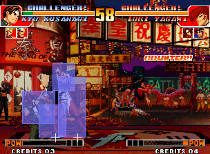
*Original: el C lejano de Iori hace counter a Kyo durante el 88 Shiki*

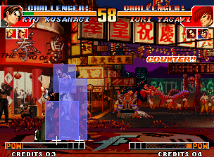
*Armadura: COUNTER y daño, pero Kyo sigue (FBNeo)*

**Resultado:** Comprobado en FBNeo: la vida de Kyo baja $67 → $57 pero se queda en el ACT $B5 (sin reacción al golpe $10A) y aun así derriba a Iori.

## 17. Haz un movimiento invencible

*Movimientos en detalle · 5 min* — Quita las hurtboxes del 88 Shiki para que los ataques lo atraviesen.

1. Abre **Animaciones → Kyo → ACT 0B5**. Cada fila de frame tiene un byte **sel**: su nibble bajo elige los slots de caja activos. El slot 0 es la caja de ataque, los slots 1-2 son hurtboxes.
2. En cada frame deja solo el bit 0: `07` → `01`, `06` → `00`, `02` → `00`. Sin hurtbox = nada que golpear = invencible. Conserva el nibble alto.
3. ¿Solo el arranque? Cambia solo los primeros frames. ¿Invulnerable a golpes pero agarrable? Añade en su lugar una caja de tipo `2C` en un slot.

> Atajo: el botón **Aplicar este ejemplo por mí** hace exactamente esta edición.

*Original: counter a Kyo*

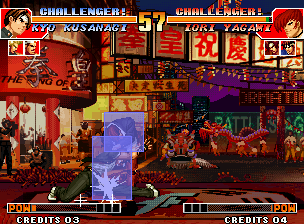
*Invencible: el C lejano de Iori atraviesa, el 88 Shiki conecta (FBNeo)*

**Resultado:** Comprobado en FBNeo: la vida de Kyo se queda en $67 y su 88 Shiki golpea a Iori dos veces ($67 → $5B).

## 18. Cambia el efecto de un golpe (eléctrico, sangre, imbloqueable…)

*Movimientos en detalle · 5 min* — Haz que el A lejano golpee con electricidad, o hazlo imbloqueable.

1. Abre **Animaciones → Kyo → ACT 051**, fila de frame con imagen `3D` (el frame de ataque). Su byte **eff** es `00`.
2. Nibble alto = efecto de impacto: `4` eléctrico, `9`/`1` sangre, `2` fuego, `3` llama morada, `7` crítico. Nibble bajo = bloqueo: `0` medio, `4` bajo, `8` overhead, `C` imbloqueable, `+3` sin empuje.
3. Prueba `40` (eléctrico), `90` (sangre) o `0C` (imbloqueable). El atajo también ensancha la hitbox para que alcance desde el inicio del round.
4. Con el emulador conectado, ⚡ Probar en vivo y golpea a Iori: la chispa cambia al instante.

> Atajo: el botón **Aplicar este ejemplo por mí** hace exactamente esta edición.

*Efecto 00: chispa blanca*

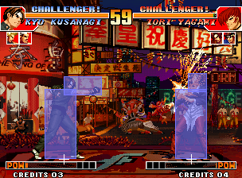
*Efecto 40: chispas eléctricas (FBNeo)*

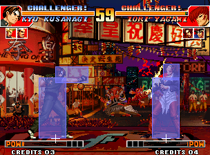
*Efecto 90: sangre (FBNeo)*

**Resultado:** Comprobado en FBNeo escribiendo el byte de efecto en vivo: $40/$C0 dan la chispa eléctrica, $90 la salpicadura de sangre.

## 19. Alarga la duración / frames activos de un movimiento

*Movimientos en detalle · 5 min* — Mantén el puño del A lejano fuera durante 24 frames.

1. Abre **Animaciones → Kyo → ACT 051**. El frame de ataque (imagen `3D`) tiene **dur `3`**.
2. Pon dur en `24` (hex `18`): el puño y su caja roja se quedan fuera 24 frames. Subir los frames de arranque hace el movimiento más lento; bajar los de recuperación lo hace más seguro.
3. Escribir / ⚡ Probar en vivo.

> Atajo: el botón **Aplicar este ejemplo por mí** hace exactamente esta edición.

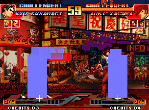
*Original en el frame 466: vuelve a la guardia*

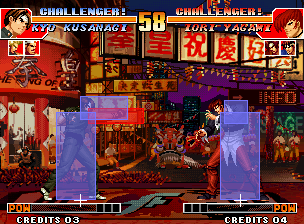
*dur 24: sigue golpeando en el frame 466 (FBNeo)*

**Resultado:** Comprobado en FBNeo: el frame 2 del ACT $51 dura del frame 452 al 478.

## 20. Movimientos completos: encuéntralos y actívalos en vivo

*En vivo · 10 min* — Ve cada movimiento como entrada → rutina → ACTs e inicia cualquiera en el juego en ejecución.

1. **Personajes y movimientos → Lista de movimientos → Kyo**: cada fila es un movimiento completo. Ejemplo: ↓→↓↘→ + A/C → rutina `$315F8` (Mu Shiki) → ACTs D0, DB, D2, D7, DC…
2. El juego lo decide en código, no en una tabla: el manejador de comandos (`$19DAC` + pers.×2, Kyo `$19E3C`) comprueba el bit del comando y los botones, y luego guarda la rutina en el objeto **+$198** y **+0**. Los supers se comprueban primero.
3. Conecta el emulador (tutorial 21) y pulsa **⚡ P1** en una fila: P1 hace ese movimiento al instante, sin entrada. Los supers necesitan poder: usa **3 barras de poder** en la pestaña En vivo.
4. La lista **Movimientos que el juego acaba de ejecutar** de la pestaña En vivo muestra cada rutina que el juego despacha mientras juegas (vigilancia en `$101D8`).

**Resultado:** Comprobado en FBNeo: escribir $315F8 en P1 +$198/+0 inició el Mu Shiki (ACT $0CB → $0CD …) sin entrada.

## 21. Edición en vivo: prueba cambios sin regenerar la ROM

*En vivo · 10 min* — Conecta FBNeo, observa el juego, congela valores, mira qué tiles hay en pantalla, envía ediciones temporales.

1. Abre HackROM Studio. Inicia KOF97 en FBNeo y luego **Game → Lua Scripting → New Lua Script Window → Browse** → la ruta de `hackrom_live.lua` que muestra la pestaña En vivo → **Run**.
2. Abre **En vivo (emulador)** y marca **activado**. Verás P1/P2: personaje, código de ACT, frame, rutina de movimiento, vida, posición y la **imagen y los tiles en pantalla** con sus offsets en la ROM C (haz clic en uno para abrirlo).
3. RAM: congela el tiempo, congela la vida, escribe cualquier dirección. Marca **dibujar hitboxes en el emulador** para ver las cajas en la ventana del juego.
4. Edita algo (p. ej. tutorial 14) y luego **⚡ Enviar mis ediciones de ROM en vivo**: el juego en marcha lo usa al instante. **Restaurar bytes originales en vivo** lo deshace. Los tiles y el sonido no se pueden cambiar en vivo.
5. Cada botón ⚡ de las otras pestañas hace lo mismo con su propia edición: Probar en vivo (Animaciones, Comandos de entrada), Parche en vivo (Código 68k, Hex), Instalar en vivo (Hooks), Enviar paleta (Paletas).

**Resultado:** Comprobado con FBNeo: estado, disparadores, congelaciones, escrituras en la ROM del banco de ACT y en la RAM de paletas funcionan con el juego en marcha.

## 23. Haz que P1 o P2 hagan cualquier cosa con el inyector Lua

*En vivo · 10 min* — Escribe un pequeño programa Lua que pulsa comandos, inicia movimientos completos y reacciona al juego, y ejecútalo en FBNeo desde la pestaña En vivo.

1. Conecta el emulador (tutorial 21) y carga el savestate de Kyo vs Iori. Baja hasta **Inyector Lua** en la pestaña En vivo.
2. Elige **Ejemplos… → P2 hace un comando** y pulsa **▶ Ejecutar en el emulador**: Iori hace `236A` (108 Shiki Yami Barai) como si lo hubiera introducido un jugador, y el registro dice cuándo vuelve a neutral.
3. Usa **Insertar un movimiento de la lista…** para añadir `move(P1, 0x2FCF0)`: el Oniyaki de Kyo empieza en el siguiente frame escribiendo su rutina en `+$198` y `+0`, sin ninguna entrada.
4. Prueba **Bot antiaéreo**: salta con P1 y P2 responde a cada salto con `623C`. **■ Detener todos los programas** lo termina.
5. Ejecuta **Vigilar la máquina de estados** y haz un especial: el registro lista cada estado (`+0`) por el que pasa el movimiento. Ábrelos en Código 68k para ver qué hace cada fase.
6. Sin la app: pon tu programa en `my_program.lua`, en la misma carpeta que `hackrom_live.lua`, y ejecuta `inject_demo.lua` de esa carpeta en FBNeo.

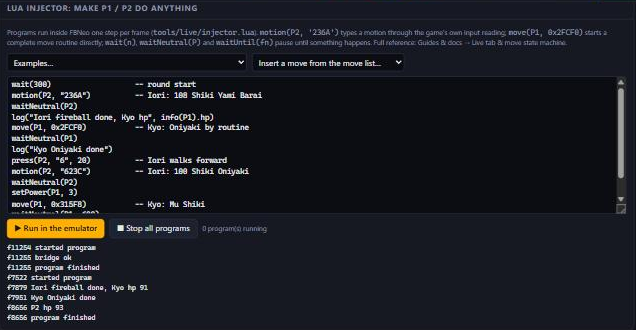
*El programa demo de KOF97 ejecutado desde la pestaña En vivo*

**Resultado:** Comprobado en FBNeo (KOF97, Kyo vs Iori): los comandos introducidos por el inyector inician $5FC50 y $5F26E de Iori, move() inicia $2FCF0 y $315F8 de Kyo desde cualquier estado, y el bot antiaéreo reacciona al salto de P1.

> Lee **Guías y documentación → Pestaña En vivo y máquina de estados de movimientos** para saber por qué funciona y qué memoria cambiar para cada resultado.

## 12. Genera y prueba en FBNeo / Fightcade

*Generar y probar · 5 min* — Exporta tu hack y juégalo sin tocar tu instalación de Fightcade.

1. Abre **Generar y exportar** y pulsa **Descargar kof97.zip**. ¡Conserva el zip original!
2. No sobrescribas el `ROMs\kof97.zip` de Fightcade. Usa un FBNeo aparte (independiente, o una copia de `Fightcade\emulator\fbneo` con su propia carpeta `ROMs`) y pon ahí el zip modificado y `neogeo.zip`.
3. FBNeo muestra un aviso con ROMs modificadas: pulsa **OK** y el juego arranca.
4. Los savestates del juego original siguen cargando (guardan la RAM, no la ROM): los cambios de gráficos, ACT, comandos y código se ven al instante; las paletas desde el siguiente round.
5. Guarda un **archivo de proyecto** para conservar solo tus cambios y volver a aplicarlos a un set limpio más tarde; los parches **IPS** funcionan con otras herramientas.
