# NeoGeo HackROM Studio — Tutorials

Hands-on lessons. KOF97 examples were applied with the app and checked in FBNeo from a savestate (Kyo vs Iori).

## 1. Load a ROM set and find your way around

*Start here · 3 min* — Open KOF97, read the ROM set page, understand undo/redo and where your edits go.

1. Open **ROM set** and drop your `kof97.zip` (from Fightcade: `Fightcade\emulator\fbneo\ROMs\kof97.zip`). Nothing is uploaded and the zip on disk is never changed.
2. Check the **Game** card: it should say The King of Fighters '97, NGH `0232`, profile **documented**, and list 4 program banks with ids `0000 0001 0002 0003`.
3. Look at **Entry points**: `USER $009868`, VBlank `$009EA2`. These are where the BIOS hands control to the game.
4. Every edit you make is listed in **Build & export → Edit history** and can be undone with **Ctrl+Z** (redo **Ctrl+Y**).
5. No ROM yet? Press **Try the synthetic demo set** on the ROM set page: it is generated data laid out like KOF97, safe to break.

## 2. Recolor a character (palettes)

*Graphics · 5 min* — Change Kyo's jacket from green to blue by editing his palette in P2 ROM.

1. Open **Palettes**. In the library on the left find **KYO KUSANAGI** and press **A**. The browser jumps to `$2D1FF0` (bank 2) and makes it the active palette.
2. Row `$2D1FF0` is Kyo's main palette. Colors **7 to 12** are the jacket and trousers (dark greens). Click color 7.
3. Drag the **B** slider up and **G** down, or use the color picker. Repeat for colors 8-12 going lighter each time.
4. Open **Sprite tiles** or **Characters & moves**: everything drawn with the active palette updates immediately.
5. Export and run. In KOF97 the palette is copied to palette RAM when a round starts, so a savestate taken mid-round shows the old colors until the next round.

> Shortcut: the **Apply this example for me** button makes this exact edit.

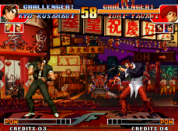
*Original (savestate, round 1)*

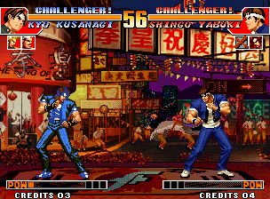
*After the edit, round 2 in FBNeo: blue jacket*

**Result:** Verified in FBNeo: after a KO the next round reloads palette $010 from ROM and Kyo appears in blue.

## 3. Edit sprite tiles

*Graphics · 5 min* — Find the tiles of Kyo's idle frames and draw on them.

1. Set Kyo's palette first (tutorial 2, step 1) so tiles show real colors.
2. Open **Characters & moves → Animations**, pick **Kyo**, ACT **000** (idle). Expand **Sprite preview setup**: it shows `frame $0000 → graph … → def $250092 … 5×7 tiles from $10000`.
3. Go to tile `$10000` in **Sprite tiles**: that's the first tile of Kyo's idle frame. Each tile shows its c1/c2 file offsets.
4. Double-click a tile, paint with color 1 (white), press **Write to ROM**.
5. Shift+click to select a block and use **Export PNG** / **Import PNG** to edit many tiles in an image editor.

> Shortcut: the **Apply this example for me** button makes this exact edit.

*Original*

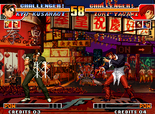
*White marks drawn on Kyo's chest tiles (FBNeo)*

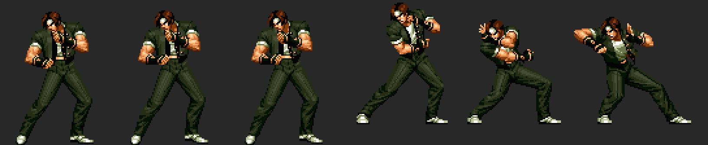
*Kyo frames decoded by the app (idle 0-2, Oniyaki E1-E3)*

**Result:** Verified in FBNeo: graphics are read live from C ROM, so tile edits show immediately, even from a savestate.

## 4. Build and import a frame

*Graphics · 10 min* — Turn a PNG into tiles in free space, ready to be used by a new animation.

1. Open **Frame builder**. Set base tile, columns and rows to look at any block of tiles (Neo Geo sprites are 16 px wide columns).
2. KOF96-98 frames store a row mask per column, so a real frame is not always a plain rectangle; the Characters preview decodes them exactly (tutorial 3, step 2).
3. Draw a frame (max 15 colors + transparent, size in multiples of 16 px) and press **Import PNG frame (use active palette)**. The app finds empty tiles and writes the frame there.
4. Note the base tile shown in the message: that's where your frame lives. Use **Import + build new palette** to also generate a palette for it.

## 22. Replace a character's sprite frame with your own PNG

*Graphics · 15 min* — Export one of Kyo's frames exactly as the game stores it, redraw it, and import it back into the same tiles.

1. Open **Characters & moves → Animations**, pick **Kyo** and ACT **051** (far A). Click frame **#2** in the timeline: image `$3D`, the punch.
2. Expand **Sprite preview setup**: the tile layout must be **per-column row masks (KOF96-98)**. It shows `def $25046E … 6×7 tiles`. Press palette **A** there so the export uses Kyo's colors.
3. Press **Export frame PNG** under the preview. You get a 96×112 px indexed PNG with Kyo's 16 colors, facing left as stored. Faint pink cells have no tile in this frame: only 22 of the 42 cells exist.
4. Redraw it in any pixel editor (Aseprite, GIMP, Photoshop in indexed mode…). Keep the size, keep transparency, use only the palette colors (others are matched to the nearest one) and stay out of the pink cells.
5. Press **Import PNG into this frame** and pick your file. Only pixels that changed are written, into the same tiles the frame already uses. The message says how many tiles changed and how many pixels fell in cells without a tile (those are ignored).
6. If some of the tiles are shared with other images (Kyo's idle frames share tiles, for example) the app lists them and asks first, because those images change too.
7. Importing the PNG you exported without editing it writes nothing: a good way to check your editor keeps the colors exact. Then **Build & export** and test in FBNeo (tutorial 12).

> Shortcut: the **Apply this example for me** button makes this exact edit.

**Result:** Verified on the real kof97 set: exporting and importing frames unchanged gives a zero byte difference in the C ROMs, and a painted edit only changes bytes inside the frame's own tiles.

> KOF97 has almost no empty tiles left in its C ROMs, so new art has to reuse the tiles a frame already has. To give a frame more tiles you need a new sprite definition (tutorial 4 shows how to place new tiles).

## 5. Edit an animation and its hitboxes (ACT)

*Characters & moves · 10 min* — Make Kyo's idle stance use another image and give it a giant hurt box.

1. Open **Characters & moves → Animations**, select **Kyo** and ACT **000**. Press **Play**: the timeline shows 10 frames with their durations; boxes are drawn per frame (solid = active).
2. Click any **frame** row in the script. The `img` field is the image id. Change every frame's img to `E3` (an Oniyaki pose).
3. Find the **FD box** rows. The type's low 2 bits are the slot; slot 1 is a hurt box. Set its `w` to 40 and `h` to 50 (half sizes).
4. Press **Write to ROM**. If a script grows it is moved to free space automatically.
5. Try others: ACT `080` is Oniyaki — its frame 3 has the attack box (type `A0`, slot 0), effect `20` (fire) and cancel `30`.

> Shortcut: the **Apply this example for me** button makes this exact edit.

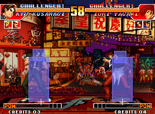
*Original idle with the box overlay*

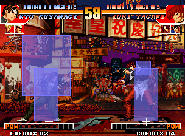
*Idle shows image E3 and the 40×50 hurt box (FBNeo)*

**Result:** Verified in FBNeo: ACT scripts are read live, the new pose and box appear immediately.

> Box overlay in the screenshots is drawn by a Lua script with the same RAM layout as Fightcade's training mode hitbox viewer (object +$90/$95/$9A/$9F).

## 6. Change a special move's input

*Characters & moves · 5 min* — Make Kyo's Oniyaki come out with down, down + any button.

1. Open **Characters & moves → Command inputs**, press **Scan** (55 tables in KOF97). Table `$A6E38` is Kyo facing right.
2. Slot **5** points to `$A7CD2`: **→ ↓ → any**, window 14 — that's Oniyaki (623+P).
3. Change the first three directions to **↓** and keep the last step as any button. Press **Write to ROM**.
4. Compare modes matter: `14` = contains the direction (lenient), `28`/`00` stricter, `04` with `F0` = any button. Lower windows make motions harder.

> Shortcut: the **Apply this example for me** button makes this exact edit.

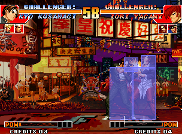
*Original: down, down+A = crouching normal*

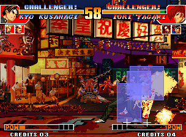
*Edited: down, down+A = Oniyaki (FBNeo)*

**Result:** Verified in FBNeo: with the edit, P1 ACT becomes $080 (Oniyaki) and Iori takes 2 hits.

## 7. Clone a move routine and change its damage

*Characters & moves · 10 min* — Copy Kyo's Oniyaki code into free space, make it hit harder and point the move to the copy.

1. Open **Characters & moves → Move routines**. Filter `2FCF0`: the row **set at $019F1A → routine $02FCF0** is Kyo's Oniyaki. (`$2FEDA` is his Red Kick.)
2. Press **clone**. The routine (105 instructions) appears as editable assembly; branches and next-frame pointers are labels like `L_02FDE4`.
3. Find the lines `move.b #$1A,($EF,a4)` / `#$1C` / `#$1B` (damage) and change them to `#$60`.
4. Pick free space (e.g. `$0F0400`) in **assemble at**, press **Assemble & write**, then **Repoint 019F1A to the new routine**.
5. Open the new address in **68k code** to read your routine.

> Shortcut: the **Apply this example for me** button makes this exact edit.

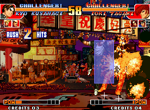
*Original Oniyaki damage*

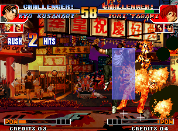
*Cloned routine at $F0434: much more damage (FBNeo)*

**Result:** Verified in FBNeo: P1's move routine pointer ($108298) reads $0F0434 and Iori loses $19 instead of $0D health.

## 8. Read and patch 68k code

*Code · 10 min* — Follow the main loop, label routines and patch an instruction.

1. Open **68k code** at `$9C38` (MainLoop_Entry). `$9C50 tst.b ($2785,a5) / beq` waits for VBlank, `$9C5C bsr $9F68` reads inputs.
2. Double-click `bsr.w $9F68` to follow it, **←** to go back. Click **Find references** to see who calls a routine.
3. Use **☆ Bookmark / label** to name routines you understand; labels show everywhere.
4. Patch: select an instruction, type new assembly (e.g. `nop`) and press **Write**. Shorter code is padded with NOPs; red bars mark modified lines.
5. Open `$101D8`: `movea.l ($198,a4),a0 / jmp (a0)` — this is where a recognised special move jumps to its routine.

## 9. Run your own code every frame (main loop hook)

*Code · 5 min* — Freeze the round timer by hooking the main loop.

1. Open **Main loop & hooks**. The known KOF97 loop is shown; the hook site defaults to `$9C44` (`move.b #$0,($2785,a5)`, 6 relocatable bytes).
2. Choose free space in P1 (e.g. `$0F0000`) and the template **Freeze round timer** (`move.b #$60,$10A83A`).
3. Read the listing: the site becomes `jmp $0F0000`; the hook saves registers, runs your code, re-runs the moved instruction and jumps back to `$9C4A`.
4. Press **Install hook**.
5. Other templates: P1 infinite health (`$108239`), max power, or a button combo that starts a move routine.

> Shortcut: the **Apply this example for me** button makes this exact edit.

*Original after 20 seconds*

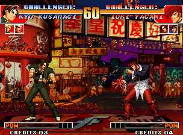
*Hooked: timer stays at 60 (FBNeo)*

**Result:** Verified in FBNeo: the timer stays at 60 for the whole run.

## 10. Edit the HUD font (fix layer)

*Graphics · 5 min* — Change the 8×8 text tiles used for names, CREDITS and messages.

1. Open **Fix layer** and go to tile `$300`: KOF97's font starts here; the CREDITS text is at `$3E0`.
2. Double-click a letter tile, edit it and **Write to ROM**.
3. Use **Export page PNG** to see a whole page of font tiles at once.

> Shortcut: the **Apply this example for me** button makes this exact edit.

*Original HUD*

*Font tiles $300-$3FF mirrored (FBNeo)*

**Result:** Verified in FBNeo: the HUD text is drawn mirrored right away.

## 11. Search and edit raw bytes

*Code · 5 min* — Use patterns to find every character's code at once.

1. Open **Hex editor**, file `232-p1.p1`. Search `397C 0080 00D2` (`move.w #$80,($D2,a4)`): 30 hits, one per character's ACT $80 special.
2. Go to offset `$A7CD2` to see the Oniyaki command bytes `04 0E 00 00 14 08 28 02 04 08 04 F0`.
3. Click a byte and type to overwrite it. Modified bytes turn red; the cursor panel shows the 68k address and the original value.

## 13. Read an animation frame by frame

*Moves in depth · 10 min* — Understand duration, image, effect, boxes and cancel of every frame of Kyo's far A.

1. Read **Guides & docs → Animation system (KOF)** first: it shows how input → handler → routine → ACT → frames → tiles fit together.
2. Open **Characters & moves → Animations**, pick **Kyo** and ACT **051** (far A). Under *Sprite preview setup* pick Kyo's palette **A**.
3. The script has 3 frames of 3 frames each. Frame 2 (image `$3D`) selects slots 0+1+2 (`sel 07`); slot 0 is the red attack box: type `30` (light normal), x `-36`, y `-84`, half size `28×8`, so it reaches 36+28 = 64 px in front.
4. Its last byte is `cc`: hitstun C, cancel C (full cancel) — that is why far A cancels into anything. Frame 3 goes back to hurt boxes only.
5. Press **▶ Play** and watch the timeline: orange = duration, HIT marks the active frame. Compare with ACT `0B5` (88 Shiki): two attack frames, cancel `00`.

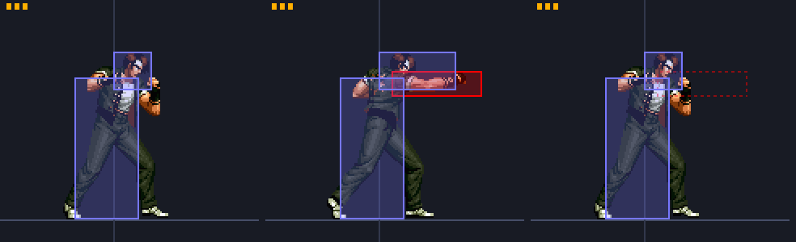
*Kyo far A rendered by the app: duration ticks, hurt boxes (blue), attack box (red), inactive boxes dashed*

## 14. Extend a hitbox

*Moves in depth · 5 min* — Give Kyo's far A a punch that reaches across the screen.

1. Open **Animations**, Kyo, ACT **051**. Click the **FD box** row with type `30` (slot 0, attack).
2. Reach = |x| + w = 36 + 28 = 64 px. At round start the fighters are 160 px apart and Iori's body box is 20 px wide, so you need |x| + w ≥ 140: set **w = 120** (reach 156). Height is h (half height).
3. Press **Write to ROM** (or **⚡ Try live** with the emulator connected).
4. Bigger boxes also need the opponent's hurt box to overlap them: a tall move needs a taller h, a low move a lower y.

> Shortcut: the **Apply this example for me** button makes this exact edit.

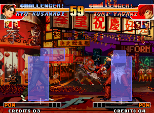
*Original far A at round start: the red box stops in the air*

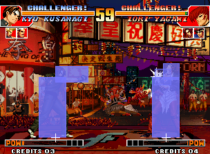
*w = 120: the same far A hits Iori across the screen (FBNeo)*

**Result:** Verified in FBNeo: Iori goes into hit ACT $100, HP $67 → $63, from the round start position.

## 15. Make a move cancelable (Kyo 88 Shiki, ↘+D)

*Moves in depth · 5 min* — Kyo's 88 Shiki can't be cancelled. Make it cancel into specials and supers.

1. Find the move: **Move list → Kyo** shows the command normal checked at `$19A90` → routine `$322D8` → ACT **B5**. That's 88 Shiki (↘ + D).
2. Open **Animations → Kyo → ACT 0B5**. Its two attack frames are the rows with **eff `04`** (low hit), images `7E` and `82`; both have **stun/cxl `00`** = not cancelable.
3. Set those two bytes to **`04`** (hitstun 14f, cancel into specials and supers). Use `08` for specials only or `0C` for anything. Leave the high nibble alone to keep the hitstun.
4. Write to ROM / ⚡ Try live.
5. How to cancel in game: the kick must **touch** the opponent, and the special's motion must be finished **during the hit freeze** — the game checks the cancel byte every frame of the freeze (code at `$163EE` → `$1E5AA`).

> Shortcut: the **Apply this example for me** button makes this exact edit.

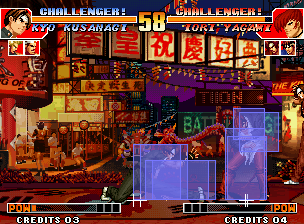
*Original: 88 Shiki hits, Oniyaki input ignored*

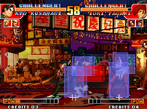
*Cancel 04: Oniyaki comes out of the 88 Shiki hit (FBNeo)*

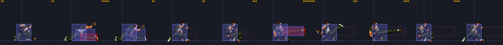
*ACT B5 frames: attack frames 2 and 6 (red)*

**Result:** Verified in FBNeo: with the same input the original keeps playing ACT $B5, the edited one switches to Oniyaki (routine $2FCF0, ACT $80) at frame 490.

## 16. Give a move armor

*Moves in depth · 10 min* — Kyo takes the hit but keeps doing 88 Shiki.

1. KOF97 has no armor flag in the animation. What the game does have: when an attacker's object byte **+$E6 bit 0** is set, its hits deal damage but cause **no hit reaction**.
2. So armor for P1 = a main loop hook that sets **P2's** `$1083E6` bit 0 while P1 plays the move (P1 ACT code at `$108172` = `$B5`) and clears it otherwise.
3. Open **Main loop & hooks**, keep the site `$9C44`, pick free space (e.g. `$0F0000`) and the template **Armor while an ACT plays** (ACT `B5`). Read the listing, then **Install hook** (or ⚡ Install live).
4. For armor on certain frames only, also compare the frame index `$108180` (P1 +$80) in the hook.
5. For P2's armor swap the addresses: test `$108372`, set `$1081E6`.

> Shortcut: the **Apply this example for me** button makes this exact edit.

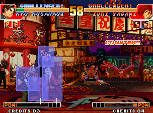
*Original: Iori's far C counter-hits Kyo out of 88 Shiki*

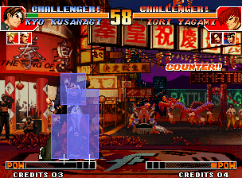
*Armor: COUNTER and damage, but Kyo keeps going (FBNeo)*

**Result:** Verified in FBNeo: Kyo's HP drops $67 → $57 but he stays in ACT $B5 (no hit reaction $10A) and still knocks Iori down.

## 17. Make a move invincible

*Moves in depth · 5 min* — Remove 88 Shiki's hurt boxes so attacks pass through it.

1. Open **Animations → Kyo → ACT 0B5**. Each frame row has a **sel** byte: its low nibble picks the live box slots. Slot 0 is the attack box, slots 1-2 are hurt boxes.
2. For every frame keep only bit 0: `07` → `01`, `06` → `00`, `02` → `00`. No hurt box = nothing to hit = invincible. Keep the high nibble.
3. Only the startup? Change only the first frames. Strike-invulnerable but throwable? Add a box of type `2C` in a slot instead.

> Shortcut: the **Apply this example for me** button makes this exact edit.

*Original: counter hit on Kyo*

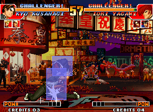
*Invincible: Iori's far C passes, 88 Shiki lands (FBNeo)*

**Result:** Verified in FBNeo: Kyo's HP stays $67 and his 88 Shiki hits Iori twice ($67 → $5B).

## 18. Change a hit's effect (electric, blood, unblockable…)

*Moves in depth · 5 min* — Make far A hit with electricity, or make it unblockable.

1. Open **Animations → Kyo → ACT 051**, frame row with image `3D` (the attack frame). Its **eff** byte is `00`.
2. High nibble = hit effect: `4` electric, `9`/`1` blood, `2` fire, `3` purple flame, `7` critical. Low nibble = guard: `0` mid, `4` low, `8` overhead, `C` unblockable, `+3` no pushback.
3. Try `40` (electric), `90` (blood) or `0C` (unblockable). The shortcut also widens the hitbox so it reaches from the round start.
4. With the emulator connected, ⚡ Try live and hit Iori: the spark changes instantly.

> Shortcut: the **Apply this example for me** button makes this exact edit.

*Effect 00: white spark*

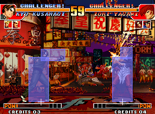
*Effect 40: electric sparks (FBNeo)*

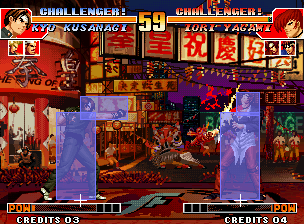
*Effect 90: blood (FBNeo)*

**Result:** Verified in FBNeo by writing the effect byte live: $40/$C0 give the electric spark, $90 the blood splash.

## 19. Extend a move's duration / active frames

*Moves in depth · 5 min* — Keep far A's punch out for 24 frames.

1. Open **Animations → Kyo → ACT 051**. The attack frame (image `3D`) has **dur `3`**.
2. Set dur to `24` (hex `18`): the punch and its red box stay out 24 frames. Raising startup frames makes the move slower; lowering recovery frames makes it safer.
3. Write / ⚡ Try live.

> Shortcut: the **Apply this example for me** button makes this exact edit.

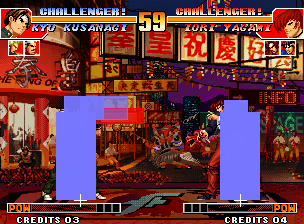
*Original at frame 466: back to idle*

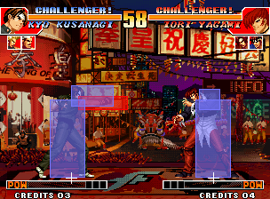
*dur 24: still punching at frame 466 (FBNeo)*

**Result:** Verified in FBNeo: frame 2 of ACT $51 stays from frame 452 to 478.

## 20. Complete moves: find them and trigger them live

*Live · 10 min* — See every move as input → routine → ACTs and start any of them on the running game.

1. **Characters & moves → Move list → Kyo**: each row is a complete move. Example: ↓→↓↘→ + A/C → routine `$315F8` (Mu Shiki) → ACTs D0, DB, D2, D7, DC…
2. The game decides it in code, not in a table: the command handler (`$19DAC` + char×2, Kyo `$19E3C`) tests the motion bit and the buttons, then stores the routine at object **+$198** and **+0**. Supers are tested first.
3. Connect the emulator (tutorial 21) and press **⚡ P1** on a row: P1 performs that move immediately, without input. Supers need power: use **3 power stocks** in the Live tab.
4. The Live tab's **Moves the game just executed** list shows every routine the game dispatches while you play (watch on `$101D8`).

**Result:** Verified in FBNeo: writing $315F8 into P1 +$198/+0 started Mu Shiki (ACT $0CB → $0CD …) with no input.

## 21. Live editing: try changes without rebuilding

*Live · 10 min* — Connect FBNeo, watch the game, freeze values, see which tiles are on screen, push edits temporarily.

1. Open HackROM Studio. Start KOF97 in FBNeo, then **Game → Lua Scripting → New Lua Script Window → Browse** → the `hackrom_live.lua` path shown in the Live tab → **Run**.
2. Open **Live (emulator)** and tick **enabled**. You see P1/P2: character, ACT code, frame, move routine, HP, position, and the **image and tiles on screen** with their C-ROM offsets (click one to open it).
3. RAM: freeze the timer, freeze HP, write any address. Tick **draw hitboxes in the emulator** to see boxes in the game window.
4. Edit something (e.g. tutorial 14), then **⚡ Push my ROM edits live**: the running game uses it immediately. **Restore original bytes live** undoes it. Tiles and sound can't be changed live.
5. Every ⚡ button in the other tabs does the same for its own edit: Try live (Animations, Command inputs), Live patch (68k code, Hex), Install live (Hooks), Send palette (Palettes).

**Result:** Verified with FBNeo: state, triggers, freezes, ROM writes into the ACT bank and palette RAM writes all work while the game runs.

## 23. Make P1 or P2 do anything with the Lua injector

*Live · 10 min* — Write a short Lua program that presses motions, starts complete moves and reacts to the game, and run it in FBNeo from the Live tab.

1. Connect the emulator (tutorial 21) and load the Kyo vs Iori savestate. Scroll to **Lua injector** in the Live tab.
2. Pick **Examples… → P2 performs a motion** and press **▶ Run in the emulator**: Iori does `236A` (108 Shiki Yami Barai) as if a player had entered it, and the log says when he is back in neutral.
3. Use **Insert a move from the move list…** to add `move(P1, 0x2FCF0)`: Kyo's Oniyaki starts on the next frame by writing its routine into `+$198` and `+0`, without any input.
4. Try **Anti-air bot**: jump with P1 and P2 answers every jump with `623C`. **■ Stop all programs** ends it.
5. Run **Watch the state machine** and do a special: the log lists every state (`+0`) the move goes through. Open them in 68k code to see what each phase does.
6. Without the app: put your program in `my_program.lua`, in the same folder as `hackrom_live.lua`, and run `inject_demo.lua` from that folder in FBNeo.

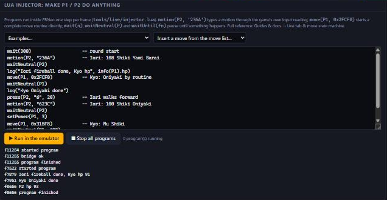
*The KOF97 demo program run from the Live tab*

**Result:** Verified in FBNeo (KOF97, Kyo vs Iori): motions typed by the injector start Iori's $5FC50 and $5F26E, move() starts Kyo's $2FCF0 and $315F8 from any state, and the anti-air bot reacts to P1's jump.

> Read **Guides & docs → Live tab & move state machine** for why this works and which memory to change for each result.

## 12. Build and test in FBNeo / Fightcade

*Build & test · 5 min* — Export your hack and play it without touching your Fightcade setup.

1. Open **Build & export** and press **Download kof97.zip**. Keep the original zip!
2. Don't overwrite Fightcade's `ROMs\kof97.zip`. Use a separate FBNeo (standalone, or a copy of `Fightcade\emulator\fbneo` with its own `ROMs` folder) and put the hacked zip plus `neogeo.zip` there.
3. FBNeo shows a warning for modified ROMs: press **OK** and the game runs.
4. Savestates from the original game still load (they store RAM, not ROM): graphics, ACT, commands and code changes show at once; palettes from the next round.
5. Save a **project file** to keep only your changes and re-apply them to a clean set later; **IPS** patches work with other tools.
