# NeoGeo HackROM Studio — Tutoriais

Lições práticas. Os exemplos de KOF97 foram aplicados com o app e verificados no FBNeo a partir de um savestate (Kyo vs Iori).

## 1. Carregue um set de ROMs e aprenda a navegar

*Comece aqui · 3 min* — Abra o KOF97, leia a página Set de ROMs, entenda desfazer/refazer e para onde vão suas edições.

1. Abra **Set de ROMs** e solte seu `kof97.zip` (do Fightcade: `Fightcade\emulator\fbneo\ROMs\kof97.zip`). Nada é enviado e o zip no disco nunca é alterado.
2. Confira o cartão **Jogo**: ele deve dizer The King of Fighters '97, NGH `0232`, perfil **documentado** e listar 4 bancos de programa com ids `0000 0001 0002 0003`.
3. Veja os **Pontos de entrada**: `USER $009868`, VBlank `$009EA2`. É aí que a BIOS passa o controle para o jogo.
4. Cada edição que você faz aparece em **Gerar e exportar → Histórico de edições** e pode ser desfeita com **Ctrl+Z** (refazer **Ctrl+Y**).
5. Ainda não tem ROM? Clique em **Testar o set de demonstração sintético** na página Set de ROMs: são dados gerados com a estrutura do KOF97, pode quebrar sem medo.

## 2. Mude as cores de um personagem (paletas)

*Gráficos · 5 min* — Mude a jaqueta do Kyo de verde para azul editando a paleta dele na ROM P2.

1. Abra **Paletas**. Na biblioteca à esquerda encontre **KYO KUSANAGI** e clique em **A**. O navegador pula para `$2D1FF0` (banco 2) e a torna a paleta ativa.
2. A linha `$2D1FF0` é a paleta principal do Kyo. As cores **7 a 12** são a jaqueta e a calça (verdes escuros). Clique na cor 7.
3. Suba o controle **B** e desça o **G**, ou use o seletor de cor. Repita para as cores 8-12, cada vez mais claras.
4. Abra **Tiles de sprites** ou **Personagens e golpes**: tudo desenhado com a paleta ativa se atualiza na hora.
5. Exporte e rode. No KOF97 a paleta é copiada para a RAM de paletas quando um round começa, então um savestate feito no meio do round mostra as cores antigas até o próximo round.

> Atalho: o botão **Aplicar este exemplo para mim** faz exatamente esta edição.

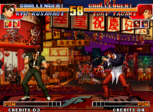
*Original (savestate, round 1)*

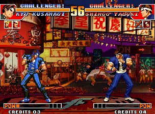
*Depois da edição, round 2 no FBNeo: jaqueta azul*

**Resultado:** Verificado no FBNeo: depois de um KO o próximo round recarrega a paleta $010 da ROM e o Kyo aparece de azul.

## 3. Edite tiles de sprites

*Gráficos · 5 min* — Encontre os tiles dos frames parados do Kyo e desenhe neles.

1. Coloque primeiro a paleta do Kyo (tutorial 2, passo 1) para os tiles mostrarem as cores reais.
2. Abra **Personagens e golpes → Animações**, escolha **Kyo**, ACT **000** (parado). Abra **Configuração da prévia do sprite**: mostra `frame $0000 → graph … → def $250092 … 5×7 tiles from $10000`.
3. Vá ao tile `$10000` em **Tiles de sprites**: é o primeiro tile do frame parado do Kyo. Cada tile mostra seus offsets nos arquivos c1/c2.
4. Clique duas vezes num tile, pinte com a cor 1 (branco), clique em **Gravar na ROM**.
5. Shift+clique para selecionar um bloco e use **Exportar PNG** / **Importar PNG** para editar muitos tiles num editor de imagens.

> Atalho: o botão **Aplicar este exemplo para mim** faz exatamente esta edição.

*Original*

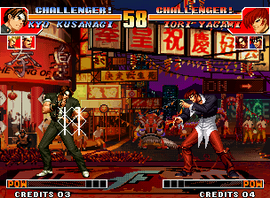
*Marcas brancas desenhadas nos tiles do peito do Kyo (FBNeo)*

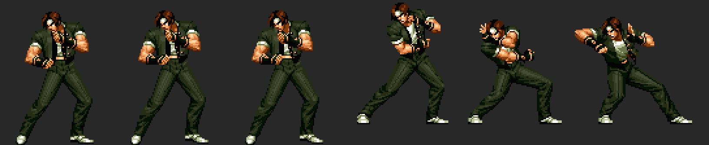
*Frames do Kyo decodificados pelo app (parado 0-2, Oniyaki E1-E3)*

**Resultado:** Verificado no FBNeo: os gráficos são lidos ao vivo da ROM C, então mudanças nos tiles aparecem na hora, mesmo a partir de um savestate.

## 4. Monte e importe um frame

*Gráficos · 10 min* — Transforme um PNG em tiles em espaço livre, prontos para uma animação nova.

1. Abra **Montador de frames**. Ajuste o tile base, as colunas e as linhas para ver qualquer bloco de tiles (os sprites do Neo Geo são colunas de 16 px de largura).
2. Os frames do KOF96-98 guardam uma máscara de linhas por coluna, então um frame real nem sempre é um retângulo simples; a prévia de Personagens os decodifica exatamente (tutorial 3, passo 2).
3. Desenhe um frame (máx. 15 cores + transparente, tamanho em múltiplos de 16 px) e clique em **Importar frame PNG (usar paleta ativa)**. O app acha tiles vazios e grava o frame lá.
4. Anote o tile base mostrado na mensagem: é lá que seu frame fica. Use **Importar + criar paleta nova** para gerar também uma paleta.

## 22. Substitua um frame de sprite de um personagem pelo seu próprio PNG

*Gráficos · 15 min* — Exporte um dos frames do Kyo exatamente como o jogo o guarda, redesenhe-o e importe-o de volta nos mesmos tiles.

1. Abra **Personagens e golpes → Animações**, escolha **Kyo** e o ACT **051** (A distante). Clique no frame **#2** da linha do tempo: imagem `$3D`, o soco.
2. Abra **Configuração da prévia do sprite**: o layout de tiles deve ser **máscaras de linhas por coluna (KOF96-98)**. Ele mostra `def $25046E … 6×7 tiles`. Clique ali na paleta **A** para que a exportação use as cores do Kyo.
3. Clique em **Exportar frame PNG** abaixo da prévia. Você recebe um PNG indexado de 96×112 px com as 16 cores do Kyo, virado para a esquerda como está guardado. As células rosa-claro não têm tile neste frame: só existem 22 das 42 células.
4. Redesenhe-o em qualquer editor de pixels (Aseprite, GIMP, Photoshop em modo indexado…). Mantenha o tamanho e a transparência, use só as cores da paleta (as outras viram a mais próxima) e não pinte nas células rosa.
5. Clique em **Importar PNG neste frame** e escolha seu arquivo. Só os pixels que mudaram são gravados, nos mesmos tiles que o frame já usa. A mensagem diz quantos tiles mudaram e quantos pixels caíram em células sem tile (esses são ignorados).
6. Se alguns tiles forem compartilhados com outras imagens (os frames parados do Kyo compartilham tiles, por exemplo), o app as lista e pergunta antes, porque essas imagens também mudam.
7. Importar o PNG exportado sem editá-lo não grava nada: um bom jeito de checar se seu editor mantém as cores exatas. Depois **Gerar e exportar** e teste no FBNeo (tutorial 12).

> Atalho: o botão **Aplicar este exemplo para mim** faz exatamente esta edição.

**Resultado:** Verificado com o set real do kof97: exportar e importar frames sem mudanças dá zero bytes de diferença nas ROMs C, e uma edição pintada só muda bytes dentro dos tiles do próprio frame.

> O KOF97 quase não tem tiles vazios nas ROMs C, então a arte nova precisa reutilizar os tiles que o frame já tem. Para dar mais tiles a um frame é preciso uma nova definição de sprite (o tutorial 4 mostra como colocar tiles novos).

## 5. Edite uma animação e suas hitboxes (ACT)

*Personagens e golpes · 10 min* — Faça a pose parada do Kyo usar outra imagem e dê a ela uma hurtbox gigante.

1. Abra **Personagens e golpes → Animações**, selecione **Kyo** e o ACT **000**. Clique em **Tocar**: a linha do tempo mostra 10 frames com suas durações; as caixas são desenhadas por frame (sólida = ativa).
2. Clique em qualquer linha de **frame** do script. O campo `img` é o id da imagem. Mude o img de cada frame para `E3` (uma pose do Oniyaki).
3. Encontre as linhas **FD caixa**. Os 2 bits baixos do tipo são o slot; o slot 1 é uma hurtbox. Coloque `w` em 40 e `h` em 50 (meios tamanhos).
4. Clique em **Gravar na ROM**. Se um script crescer ele é movido para espaço livre automaticamente.
5. Teste outros: o ACT `080` é o Oniyaki; seu frame 3 tem a caixa de ataque (tipo `A0`, slot 0), efeito `20` (fogo) e cancel `30`.

> Atalho: o botão **Aplicar este exemplo para mim** faz exatamente esta edição.

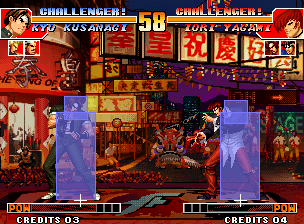
*Parado original com as caixas sobrepostas*

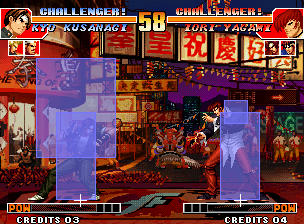
*Parado mostra a imagem E3 e a hurtbox de 40×50 (FBNeo)*

**Resultado:** Verificado no FBNeo: os scripts ACT são lidos ao vivo, a nova pose e a caixa aparecem na hora.

> As caixas das capturas são desenhadas por um script Lua com a mesma estrutura de RAM do visualizador de hitboxes do modo de treino do Fightcade (objeto +$90/$95/$9A/$9F).

## 6. Mude o comando de um especial

*Personagens e golpes · 5 min* — Faça o Oniyaki do Kyo sair com baixo, baixo + qualquer botão.

1. Abra **Personagens e golpes → Comandos de entrada**, clique em **Escanear** (55 tabelas no KOF97). A tabela `$A6E38` é o Kyo olhando para a direita.
2. O slot **5** aponta para `$A7CD2`: **→ ↓ → qualquer**, janela 14: é o Oniyaki (623+P).
3. Mude as três primeiras direções para **↓** e deixe o último passo como qualquer botão. Clique em **Gravar na ROM**.
4. Os modos de comparação importam: `14` = contém a direção (permissivo), `28`/`00` mais rígidos, `04` com `F0` = qualquer botão. Janelas menores deixam os comandos mais difíceis.

> Atalho: o botão **Aplicar este exemplo para mim** faz exatamente esta edição.

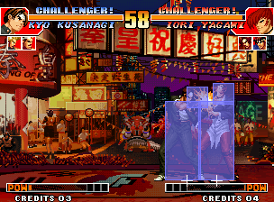
*Original: baixo, baixo+A = normal agachado*

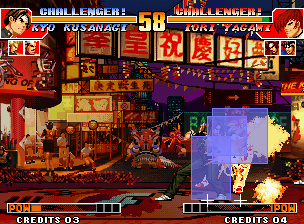
*Editado: baixo, baixo+A = Oniyaki (FBNeo)*

**Resultado:** Verificado no FBNeo: com a edição, o ACT da P1 vira $080 (Oniyaki) e o Iori leva 2 golpes.

## 7. Clone uma rotina de golpe e mude o dano

*Personagens e golpes · 10 min* — Copie o código do Oniyaki do Kyo para espaço livre, faça-o bater mais forte e aponte o golpe para a cópia.

1. Abra **Personagens e golpes → Rotinas de golpe**. Filtre `2FCF0`: a linha **set at $019F1A → routine $02FCF0** é o Oniyaki do Kyo. (`$2FEDA` é o Red Kick dele.)
2. Clique em **clonar**. A rotina (105 instruções) aparece como assembly editável; saltos e ponteiros para o próximo frame são rótulos como `L_02FDE4`.
3. Encontre as linhas `move.b #$1A,($EF,a4)` / `#$1C` / `#$1B` (dano) e mude para `#$60`.
4. Escolha espaço livre (ex. `$0F0400`) em **montar em**, clique em **Montar e gravar** e depois **Redirecionar 019F1A para a nova rotina**.
5. Abra o novo endereço em **Código 68k** para ler sua rotina.

> Atalho: o botão **Aplicar este exemplo para mim** faz exatamente esta edição.

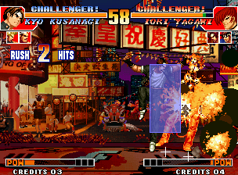
*Dano original do Oniyaki*

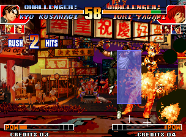
*Rotina clonada em $F0434: muito mais dano (FBNeo)*

**Resultado:** Verificado no FBNeo: o ponteiro de rotina de golpe da P1 ($108298) vale $0F0434 e o Iori perde $19 de vida em vez de $0D.

## 8. Leia e modifique código 68k

*Código · 10 min* — Siga o loop principal, rotule rotinas e modifique uma instrução.

1. Abra **Código 68k** em `$9C38` (MainLoop_Entry). `$9C50 tst.b ($2785,a5) / beq` espera o VBlank, `$9C5C bsr $9F68` lê as entradas.
2. Clique duas vezes em `bsr.w $9F68` para segui-lo, **←** para voltar. Clique em **Buscar referências** para ver quem chama uma rotina.
3. Use **☆ Marcador / rótulo** para nomear as rotinas que você entender; os rótulos aparecem em todo lugar.
4. Patch: selecione uma instrução, digite o novo assembly (ex. `nop`) e clique em **Gravar**. Código mais curto é completado com NOPs; barras vermelhas marcam as linhas modificadas.
5. Abra `$101D8`: `movea.l ($198,a4),a0 / jmp (a0)`: é aqui que um especial reconhecido pula para sua rotina.

## 9. Rode seu próprio código a cada frame (hook do loop principal)

*Código · 5 min* — Congele o tempo do round com um hook no loop principal.

1. Abra **Loop principal e hooks**. O loop conhecido do KOF97 é mostrado; o ponto do hook padrão é `$9C44` (`move.b #$0,($2785,a5)`, 6 bytes realocáveis).
2. Escolha espaço livre na P1 (ex. `$0F0000`) e o modelo **Congelar o tempo do round** (`move.b #$60,$10A83A`).
3. Leia a listagem: o ponto vira `jmp $0F0000`; o hook salva os registradores, roda seu código, roda de novo a instrução movida e volta para `$9C4A`.
4. Clique em **Instalar hook**.
5. Outros modelos: vida infinita da P1 (`$108239`), poder máximo, ou um combo de botões que inicia uma rotina de golpe.

> Atalho: o botão **Aplicar este exemplo para mim** faz exatamente esta edição.

*Original depois de 20 segundos*

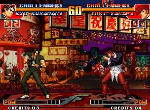
*Com hook: o tempo fica em 60 (FBNeo)*

**Resultado:** Verificado no FBNeo: o tempo fica em 60 durante todo o teste.

## 10. Edite a fonte do HUD (camada fix)

*Gráficos · 5 min* — Mude os tiles de texto 8×8 usados em nomes, CREDITS e mensagens.

1. Abra **Camada fix** e vá ao tile `$300`: a fonte do KOF97 começa aqui; o texto CREDITS está em `$3E0`.
2. Clique duas vezes no tile de uma letra, edite e **Gravar na ROM**.
3. Use **Exportar página PNG** para ver uma página inteira de tiles de fonte de uma vez.

> Atalho: o botão **Aplicar este exemplo para mim** faz exatamente esta edição.

*HUD original*

*Tiles de fonte $300-$3FF espelhados (FBNeo)*

**Resultado:** Verificado no FBNeo: o texto do HUD é desenhado espelhado na hora.

## 11. Busque e edite bytes brutos

*Código · 5 min* — Use padrões para encontrar o código de todos os personagens de uma vez.

1. Abra **Editor hex**, arquivo `232-p1.p1`. Busque `397C 0080 00D2` (`move.w #$80,($D2,a4)`): 30 resultados, um para o especial ACT $80 de cada personagem.
2. Vá ao offset `$A7CD2` para ver os bytes do comando do Oniyaki `04 0E 00 00 14 08 28 02 04 08 04 F0`.
3. Clique num byte e digite para sobrescrevê-lo. Bytes modificados ficam vermelhos; o painel do cursor mostra o endereço 68k e o valor original.

## 13. Leia uma animação frame a frame

*Golpes em detalhe · 10 min* — Entenda a duração, imagem, efeito, caixas e cancel de cada frame do A distante do Kyo.

1. Leia primeiro **Guias e documentação → Sistema de animação (KOF)**: mostra como entrada → manipulador → rotina → ACT → frames → tiles se encaixam.
2. Abra **Personagens e golpes → Animações**, escolha **Kyo** e o ACT **051** (A distante). Em *Configuração da prévia do sprite* escolha a paleta **A** do Kyo.
3. O script tem 3 frames de 3 frames cada. O frame 2 (imagem `$3D`) seleciona os slots 0+1+2 (`sel 07`); o slot 0 é a caixa de ataque vermelha: tipo `30` (normal fraco), x `-36`, y `-84`, meio tamanho `28×8`, então alcança 36+28 = 64 px à frente.
4. Seu último byte é `cc`: hitstun C, cancel C (cancel total); é por isso que o A distante cancela em qualquer coisa. O frame 3 volta a ter só hurtboxes.
5. Clique em **▶ Tocar** e veja a linha do tempo: laranja = duração, ACERTO marca o frame ativo. Compare com o ACT `0B5` (88 Shiki): dois frames de ataque, cancel `00`.

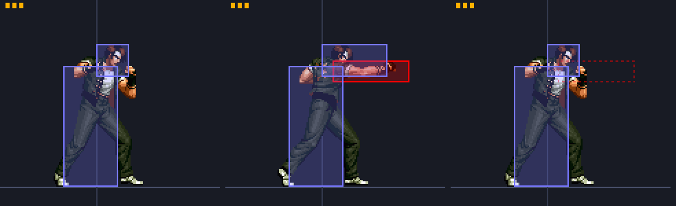
*A distante do Kyo desenhado pelo app: marcas de duração, hurtboxes (azul), caixa de ataque (vermelho), caixas inativas tracejadas*

## 14. Aumente uma hitbox

*Golpes em detalhe · 5 min* — Dê ao A distante do Kyo um soco que atravesse a tela.

1. Abra **Animações**, Kyo, ACT **051**. Clique na linha **FD caixa** com tipo `30` (slot 0, ataque).
2. Alcance = |x| + w = 36 + 28 = 64 px. No início do round os lutadores estão a 160 px e a caixa do corpo do Iori tem 20 px de largura, então você precisa de |x| + w ≥ 140: coloque **w = 120** (alcance 156). A altura é h (meia altura).
3. Clique em **Gravar na ROM** (ou **⚡ Testar ao vivo** com o emulador conectado).
4. Caixas maiores também precisam que a hurtbox do oponente se sobreponha: um golpe alto precisa de mais h, um baixo de um y mais baixo.

> Atalho: o botão **Aplicar este exemplo para mim** faz exatamente esta edição.

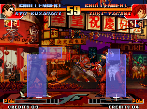
*A distante original no início do round: a caixa vermelha para no ar*

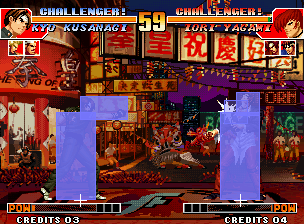
*w = 120: o mesmo A distante acerta o Iori do outro lado da tela (FBNeo)*

**Resultado:** Verificado no FBNeo: o Iori entra no ACT de golpe $100, vida $67 → $63, a partir da posição de início do round.

## 15. Torne um golpe cancelável (88 Shiki do Kyo, ↘+D)

*Golpes em detalhe · 5 min* — O 88 Shiki do Kyo não pode ser cancelado. Faça-o cancelar em especiais e supers.

1. Encontre o golpe: **Lista de golpes → Kyo** mostra o normal de comando checado em `$19A90` → rotina `$322D8` → ACT **B5**. Esse é o 88 Shiki (↘ + D).
2. Abra **Animações → Kyo → ACT 0B5**. Seus dois frames de ataque são as linhas com **eff `04`** (golpe baixo), imagens `7E` e `82`; ambas têm **stun/cxl `00`** = não cancelável.
3. Coloque esses dois bytes em **`04`** (hitstun 14f, cancel para especiais e supers). Use `08` para só especiais ou `0C` para qualquer coisa. Não mexa no nibble alto para manter o hitstun.
4. Gravar na ROM / ⚡ Testar ao vivo.
5. Como cancelar no jogo: o chute precisa **tocar** o oponente e o comando do especial precisa terminar **durante a pausa de impacto**; o jogo checa o byte de cancel a cada frame da pausa (código em `$163EE` → `$1E5AA`).

> Atalho: o botão **Aplicar este exemplo para mim** faz exatamente esta edição.

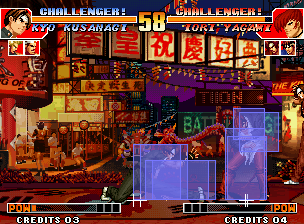
*Original: o 88 Shiki acerta, o comando do Oniyaki é ignorado*

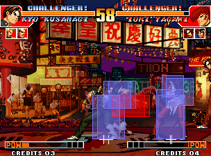
*Cancel 04: o Oniyaki sai do golpe do 88 Shiki (FBNeo)*

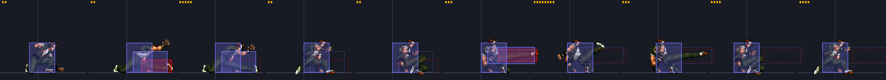
*Frames do ACT B5: frames de ataque 2 e 6 (vermelho)*

**Resultado:** Verificado no FBNeo: com a mesma entrada o original continua tocando o ACT $B5 e o editado muda para o Oniyaki (rotina $2FCF0, ACT $80) no frame 490.

## 16. Dê armadura a um golpe

*Golpes em detalhe · 10 min* — O Kyo leva o golpe mas continua fazendo o 88 Shiki.

1. O KOF97 não tem flag de armadura na animação. O que ele tem: quando o byte do objeto atacante **+$E6 bit 0** está ligado, seus golpes causam dano mas **nenhuma reação**.
2. Então armadura para a P1 = um hook no loop principal que liga o bit 0 de `$1083E6` da **P2** enquanto a P1 faz o golpe (código de ACT da P1 em `$108172` = `$B5`) e o desliga caso contrário.
3. Abra **Loop principal e hooks**, mantenha o ponto `$9C44`, escolha espaço livre (ex. `$0F0000`) e o modelo **Armadura enquanto um ACT toca** (ACT `B5`). Leia a listagem e depois **Instalar hook** (ou ⚡ Instalar ao vivo).
4. Para armadura só em certos frames, compare também o índice de frame `$108180` (P1 +$80) no hook.
5. Para a armadura da P2 troque os endereços: teste `$108372`, ligue `$1081E6`.

> Atalho: o botão **Aplicar este exemplo para mim** faz exatamente esta edição.

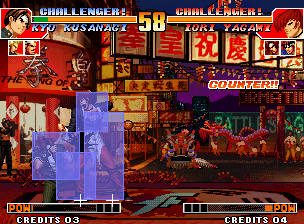
*Original: o C distante do Iori dá counter no Kyo durante o 88 Shiki*

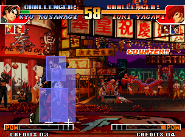
*Armadura: COUNTER e dano, mas o Kyo continua (FBNeo)*

**Resultado:** Verificado no FBNeo: a vida do Kyo cai $67 → $57 mas ele fica no ACT $B5 (sem reação ao golpe $10A) e ainda derruba o Iori.

## 17. Torne um golpe invencível

*Golpes em detalhe · 5 min* — Remova as hurtboxes do 88 Shiki para que os ataques o atravessem.

1. Abra **Animações → Kyo → ACT 0B5**. Cada linha de frame tem um byte **sel**: seu nibble baixo escolhe os slots de caixa ativos. O slot 0 é a caixa de ataque, os slots 1-2 são hurtboxes.
2. Em cada frame deixe só o bit 0: `07` → `01`, `06` → `00`, `02` → `00`. Sem hurtbox = nada para acertar = invencível. Mantenha o nibble alto.
3. Só o início? Mude só os primeiros frames. Invulnerável a golpes mas agarrável? Adicione em vez disso uma caixa do tipo `2C` num slot.

> Atalho: o botão **Aplicar este exemplo para mim** faz exatamente esta edição.

*Original: counter no Kyo*

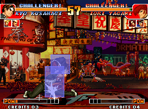
*Invencível: o C distante do Iori atravessa, o 88 Shiki acerta (FBNeo)*

**Resultado:** Verificado no FBNeo: a vida do Kyo fica em $67 e o 88 Shiki dele acerta o Iori duas vezes ($67 → $5B).

## 18. Mude o efeito de um golpe (elétrico, sangue, indefensável…)

*Golpes em detalhe · 5 min* — Faça o A distante acertar com eletricidade, ou torne-o indefensável.

1. Abra **Animações → Kyo → ACT 051**, linha de frame com imagem `3D` (o frame de ataque). Seu byte **eff** é `00`.
2. Nibble alto = efeito de impacto: `4` elétrico, `9`/`1` sangue, `2` fogo, `3` chama roxa, `7` crítico. Nibble baixo = defesa: `0` médio, `4` baixo, `8` overhead, `C` indefensável, `+3` sem empurrão.
3. Teste `40` (elétrico), `90` (sangue) ou `0C` (indefensável). O atalho também alarga a hitbox para alcançar desde o início do round.
4. Com o emulador conectado, ⚡ Testar ao vivo e acerte o Iori: a faísca muda na hora.

> Atalho: o botão **Aplicar este exemplo para mim** faz exatamente esta edição.

*Efeito 00: faísca branca*

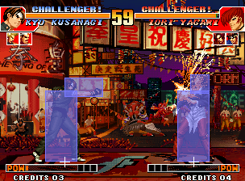
*Efeito 40: faíscas elétricas (FBNeo)*

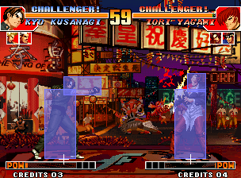
*Efeito 90: sangue (FBNeo)*

**Resultado:** Verificado no FBNeo gravando o byte de efeito ao vivo: $40/$C0 dão a faísca elétrica, $90 o respingo de sangue.

## 19. Aumente a duração / frames ativos de um golpe

*Golpes em detalhe · 5 min* — Mantenha o soco do A distante fora por 24 frames.

1. Abra **Animações → Kyo → ACT 051**. O frame de ataque (imagem `3D`) tem **dur `3`**.
2. Coloque dur em `24` (hex `18`): o soco e sua caixa vermelha ficam fora por 24 frames. Aumentar os frames de início deixa o golpe mais lento; diminuir os de recuperação o deixa mais seguro.
3. Gravar / ⚡ Testar ao vivo.

> Atalho: o botão **Aplicar este exemplo para mim** faz exatamente esta edição.

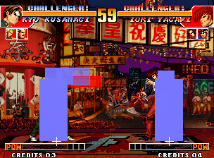
*Original no frame 466: volta a ficar parado*

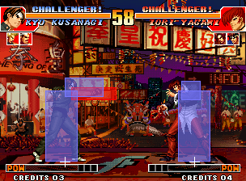
*dur 24: ainda socando no frame 466 (FBNeo)*

**Resultado:** Verificado no FBNeo: o frame 2 do ACT $51 fica do frame 452 ao 478.

## 20. Golpes completos: encontre-os e ative-os ao vivo

*Ao vivo · 10 min* — Veja cada golpe como entrada → rotina → ACTs e inicie qualquer um no jogo rodando.

1. **Personagens e golpes → Lista de golpes → Kyo**: cada linha é um golpe completo. Exemplo: ↓→↓↘→ + A/C → rotina `$315F8` (Mu Shiki) → ACTs D0, DB, D2, D7, DC…
2. O jogo decide isso em código, não numa tabela: o manipulador de comandos (`$19DAC` + pers.×2, Kyo `$19E3C`) testa o bit do comando e os botões, e depois guarda a rotina no objeto **+$198** e **+0**. Os supers são testados primeiro.
3. Conecte o emulador (tutorial 21) e clique em **⚡ P1** numa linha: a P1 faz esse golpe na hora, sem comando. Supers precisam de poder: use **3 barras de poder** na aba Ao vivo.
4. A lista **Golpes que o jogo acabou de executar** da aba Ao vivo mostra cada rotina que o jogo despacha enquanto você joga (observação em `$101D8`).

**Resultado:** Verificado no FBNeo: gravar $315F8 em P1 +$198/+0 iniciou o Mu Shiki (ACT $0CB → $0CD …) sem comando.

## 21. Edição ao vivo: teste mudanças sem gerar a ROM de novo

*Ao vivo · 10 min* — Conecte o FBNeo, observe o jogo, congele valores, veja quais tiles estão na tela, envie edições temporárias.

1. Abra o HackROM Studio. Inicie o KOF97 no FBNeo e depois **Game → Lua Scripting → New Lua Script Window → Browse** → o caminho de `hackrom_live.lua` mostrado na aba Ao vivo → **Run**.
2. Abra **Ao vivo (emulador)** e marque **ativado**. Você vê P1/P2: personagem, código de ACT, frame, rotina de golpe, vida, posição e a **imagem e os tiles na tela** com seus offsets na ROM C (clique num para abri-lo).
3. RAM: congele o tempo, congele a vida, grave qualquer endereço. Marque **desenhar hitboxes no emulador** para ver as caixas na janela do jogo.
4. Edite algo (ex. tutorial 14) e depois **⚡ Enviar minhas edições de ROM ao vivo**: o jogo rodando usa na hora. **Restaurar bytes originais ao vivo** desfaz. Tiles e som não podem ser mudados ao vivo.
5. Cada botão ⚡ das outras abas faz o mesmo com sua própria edição: Testar ao vivo (Animações, Comandos de entrada), Patch ao vivo (Código 68k, Hex), Instalar ao vivo (Hooks), Enviar paleta (Paletas).

**Resultado:** Verificado com FBNeo: estado, gatilhos, congelamentos, gravações na ROM do banco de ACT e na RAM de paletas funcionam com o jogo rodando.

## 23. Faça a P1 ou a P2 fazer qualquer coisa com o injetor Lua

*Ao vivo · 10 min* — Escreva um pequeno programa Lua que aperta comandos, inicia golpes completos e reage ao jogo, e rode no FBNeo pela aba Ao vivo.

1. Conecte o emulador (tutorial 21) e carregue o savestate do Kyo vs Iori. Desça até **Injetor Lua** na aba Ao vivo.
2. Escolha **Exemplos… → A P2 faz um comando** e clique em **▶ Rodar no emulador**: o Iori faz `236A` (108 Shiki Yami Barai) como se um jogador tivesse feito, e o registro diz quando ele volta ao neutro.
3. Use **Inserir um golpe da lista…** para adicionar `move(P1, 0x2FCF0)`: o Oniyaki do Kyo começa no próximo frame gravando a rotina dele em `+$198` e `+0`, sem nenhuma entrada.
4. Teste **Bot antiaéreo**: pule com a P1 e a P2 responde a cada pulo com `623C`. **■ Parar todos os programas** termina.
5. Rode **Observar a máquina de estados** e faça um especial: o registro lista cada estado (`+0`) pelo qual o golpe passa. Abra-os em Código 68k para ver o que cada fase faz.
6. Sem o app: coloque seu programa em `my_program.lua`, na mesma pasta de `hackrom_live.lua`, e rode `inject_demo.lua` dessa pasta no FBNeo.

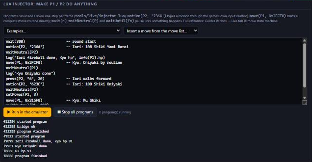
*O programa demo do KOF97 rodado pela aba Ao vivo*

**Resultado:** Verificado no FBNeo (KOF97, Kyo vs Iori): os comandos digitados pelo injetor iniciam $5FC50 e $5F26E do Iori, move() inicia $2FCF0 e $315F8 do Kyo a partir de qualquer estado, e o bot antiaéreo reage ao pulo da P1.

> Leia **Guias e documentação → Aba Ao vivo e máquina de estados dos golpes** para saber por que funciona e qual memória mudar para cada resultado.

## 12. Gere e teste no FBNeo / Fightcade

*Gerar e testar · 5 min* — Exporte seu hack e jogue sem mexer na sua instalação do Fightcade.

1. Abra **Gerar e exportar** e clique em **Baixar kof97.zip**. Guarde o zip original!
2. Não sobrescreva o `ROMs\kof97.zip` do Fightcade. Use um FBNeo separado (avulso, ou uma cópia de `Fightcade\emulator\fbneo` com sua própria pasta `ROMs`) e coloque lá o zip modificado e o `neogeo.zip`.
3. O FBNeo mostra um aviso com ROMs modificadas: clique em **OK** e o jogo roda.
4. Savestates do jogo original continuam carregando (guardam a RAM, não a ROM): mudanças de gráficos, ACT, comandos e código aparecem na hora; paletas a partir do próximo round.
5. Salve um **arquivo de projeto** para guardar só suas mudanças e reaplicá-las num set limpo depois; patches **IPS** funcionam com outras ferramentas.
